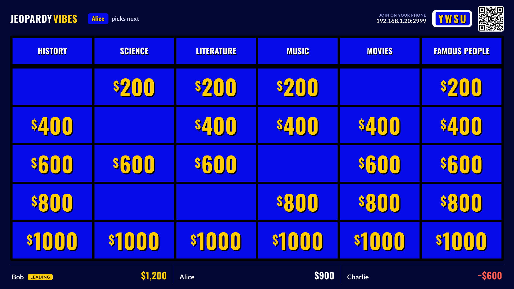
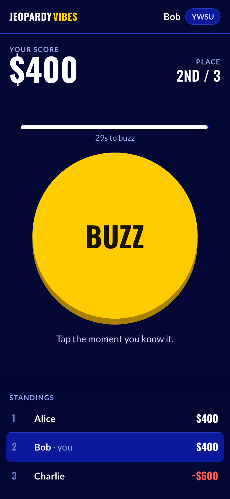
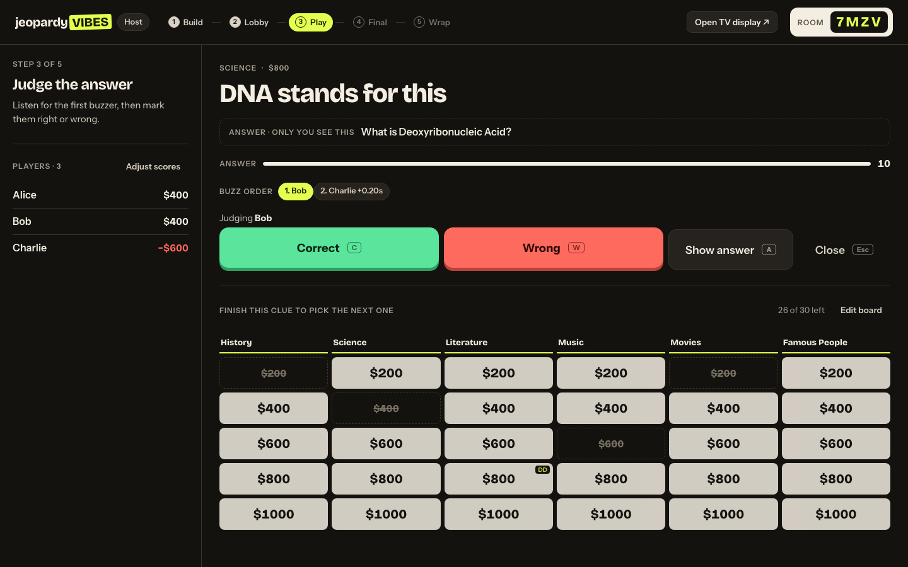
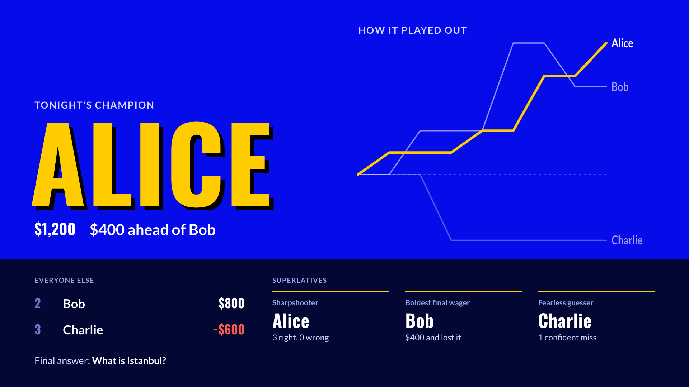
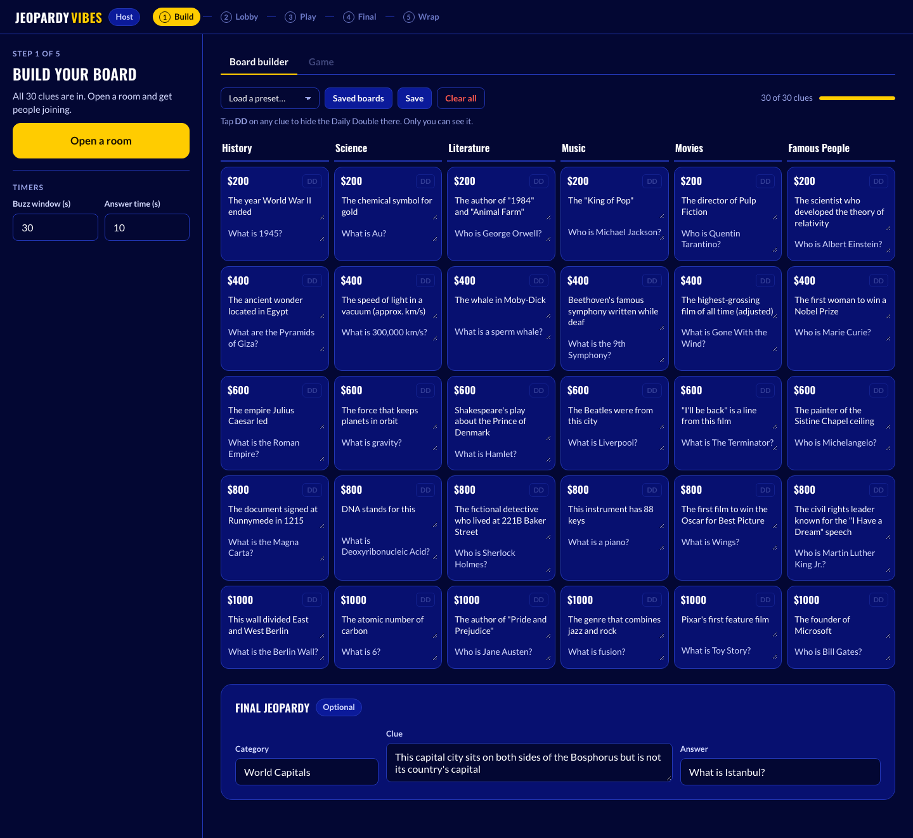
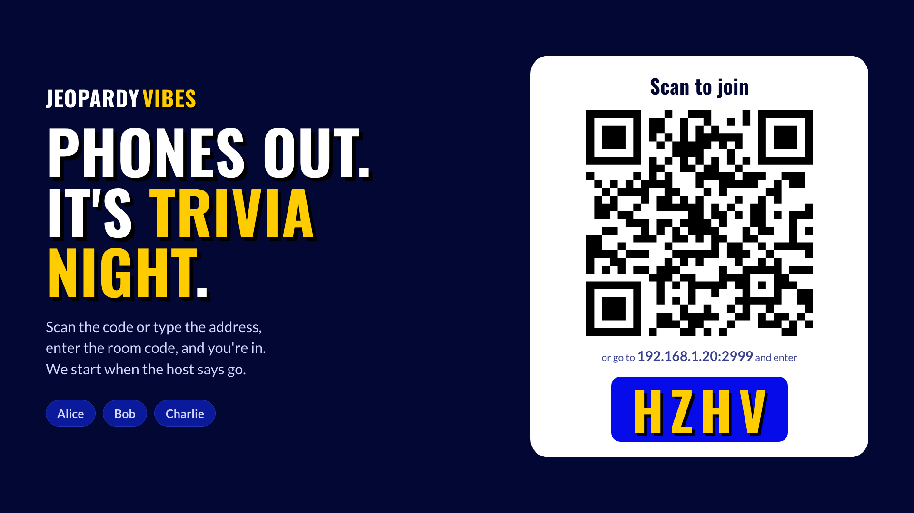

# Jeopardy

A self-hosted multiplayer Jeopardy game for local play. One device runs the host panel, one is projected to the TV as the board, and players join from their phones.

## Hosted Version

This game is also publicly accessible at:

https://jeopardy.kaolun.org

## Requirements

- Go 1.23 or newer

## Setup

```bash
go run .
```

Or build a single binary (the `public/` folder is embedded, so it runs from anywhere):

```bash
go build -o jeopardy .
./jeopardy
```

The server starts on port 2999 by default. Set `PORT` to change it, and `PING_TIMEOUT_MS` (default 60000) to control how long a silent phone stays connected.

Run the tests with `go test ./...`.

## Server Layout

| File | What it does |
| --- | --- |
| `main.go` | HTTP server: static files, `/api/info`, `/ws` |
| `ws.go` | WebSocket connections, the JSON wire format, ping/keepalive |
| `game.go` | Game rooms and every game event (buzzing, scoring, Daily Double, Final Jeopardy) |
| `public/socket.js` | Small browser client with a Socket.IO-style `on` / `emit` API over a plain WebSocket |

Messages are JSON: the client sends `{"e": "event", "d": payload, "ack": n}` and the server replies with events `{"e": "event", "d": payload}` or acks `{"ack": n, "d": response}`.

## Playing on a Local Network

All devices must be on the same WiFi network. Find your machine's local IP address:

- Mac: `ipconfig getifaddr en0`
- Linux: `hostname -I`
- Windows: `ipconfig` (look for IPv4 Address)

Then share the URL with everyone: `http://YOUR_IP:2999`

## How It Works

There are four views:

| View          | URL            | Used by             |
| ------------- | -------------- | ------------------- |
| Join / Home   | `/`            | Players to join     |
| Host Panel    | `/host.html`   | Game host           |
| Board Display | `/board.html`  | TV or projector     |
| Player View   | `/player.html` | Each player's phone |

| TV board | Phone buzzer |
| --- | --- |
|  |  |
|  |  |
|  |  |

## Running a Game

1. Open `/host.html` on your device
2. Pick a board from **Boards** (or write your own), then click **Open a room**
3. Click **Open TV display** and put that window on the TV. It shows a QR code and the room code
4. Players scan the QR code (or open `/` on their phones) and enter their name and the room code
5. Click **Start game** in the host panel

The host sidebar always shows the one next step for the current phase (Build → Lobby → Play → Final → Wrap).
While a clue is open, the host can judge with the keyboard: **C** correct, **W** wrong, **A** show the answer on the TV, **Esc** close the clue.

The TV figures out your machine's LAN address for the join link and QR code. Fonts and the QR library are served locally, so the game works on a network with no internet access.

## Board Builder

- Six categories, five clues each ($200 - $1000)
- Tap **DD** on any clue to make it the Daily Double (only the host sees it)
- Name the board at the top and click **Save** (or ⌘/Ctrl+S). Saving again updates the same board; the status next to the name shows **Saved** or **Unsaved changes**
- Everything you type is also kept as a draft in the browser, so a reload or closed tab doesn't lose work
- **Boards** opens your saved boards (open, duplicate, delete with undo) and four starter boards: Family night, General knowledge, Expert, College night. A starter opens as a new unsaved copy
- You're asked before anything replaces unsaved changes
- **Export this board** / **Import from file** move a board to another computer as a `.json` file
- **Open a room** warns you if any clues are empty and outlines them on the grid
- During a game, **Edit board** lets you fix clues and send them to the TV with **Update the TV**. Played clues stay played and scores don't change

## Daily Double

When a Daily Double clue is selected, the TV announces it and the host panel shows a wager form. The player who answered the last clue correctly is preselected. The host enters a wager (quick picks: minimum, half, or a true Daily Double), then clicks **Show clue on TV**. Scoring is based on the wager rather than the face value.

## Final Jeopardy

1. When the board is cleared, click **Start Final Jeopardy** (or **Skip to Final Jeopardy** in the sidebar)
2. Check the category, clue, and correct answer (prefilled from the board builder)
3. Click **Start Final Jeopardy**. Players see a wager screen on their phones
4. Once wagers are in, click **Reveal the clue**
5. Players type their answers on their phones; only the host sees them
6. The host marks each answer correct or wrong
7. Click **Show the winner** to put the podium, score chart, and superlatives on the TV

At the end, **Copy results for the group chat** on the host panel copies the standings and superlatives as text.

## Scoring

- Correct buzz: +face value (or wager for DD/FJ)
- Wrong answer: -face value, and the next buzzer in line gets to answer
- Scores can be manually adjusted in the host panel

## Resetting

Click **Reset scores & board…** in the host sidebar (or **Play again** at the end) to reset all scores and re-open all clues without disconnecting players.
